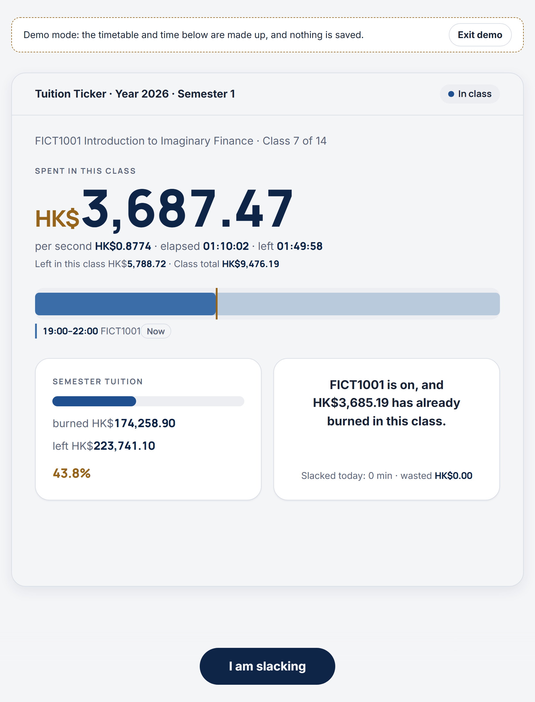
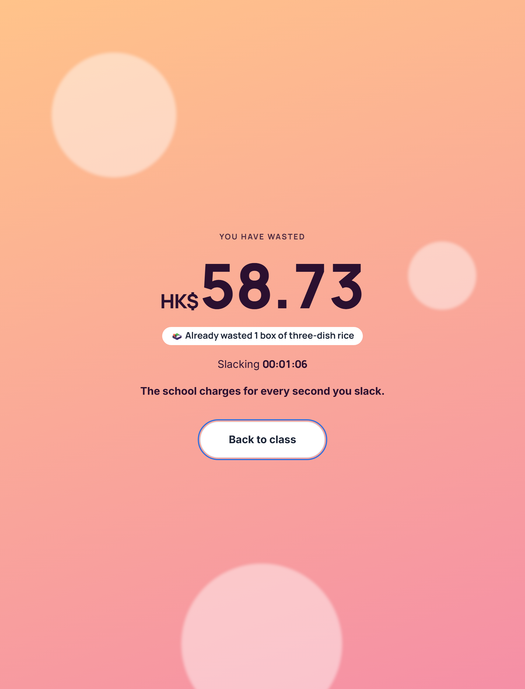

# Uni Motivator

**English** | [简体中文](README.zh-CN.md)

> Your tuition is a taxi meter, and you are the passenger scrolling your phone in the back seat.

**Uni Motivator** (it calls itself *Tuition Ticker* inside the app, 学费计价器 in Chinese) turns the tuition you paid into a cost per second. Feed it your timetable and it knows when you are in class, then shows how much money has burned in this very lecture, live, to the cent. Slack off and the meter keeps running, now on a full-screen page that tells you which snack you just threw away. Everything runs on your own computer. Free and open source.

| Mid-lecture: the meter is running | One click on "I am slacking" |
|:-:|:-:|
|  |  |

<sub>Screenshots come from the built-in demo mode: the timetable and the money are made up.</sub>

## Features

**Live cost meter**

- A per-second money counter for the class you are in: spent so far, left in this class, class total, cost per second, elapsed and remaining time, plus a progress bar.
- The screen follows your day on its own: in class, break, done for today, no class today, term not started, term over. Nothing to start or stop.
- Semester (or year) tuition "fuel tank", today's timeline, and overlapping classes with a one-click switch.
- The browser tab title shows the live amount, so you can watch it burn from another tab.
- Rotating copy lines in three tones: gentle, normal, maximum anxiety.
- Peek-proof mode: press `B` to blur every amount when someone walks past.

**Slacking mode**

- "I am slacking" opens a full-screen page with a live counter of the money you are wasting.
- It translates the money into everyday things (egg tarts, milk tea, boxes of rice, movie tickets, a flight to Tokyo ...) from a built-in price pack of 17 items.
- A settlement card when you come back, with the duration, the equivalent and your total slacking in this class. Slacking ends by itself when the class ends.

**Classes, marks and stats**

- Weekly class list: mark classes as skipped or cancelled, enter minutes you were late or left early, and see what the school swallowed and what you lost.
- Skip calculator: "Skipping this class = throwing away HK$X, about N bowls of noodles".
- Statistics for the week, semester and year: spending, class hours, attendance, slacking total and rate, your favourite course to slack in, longest slack, most expensive class, course ranking with cost per hour, a weekly spending chart and a year-by-year history.
- Share card: one click makes a 1080 x 1440 PNG with your numbers. It contains no name and no school name.
- Class reminders: browser notifications before a class starts and a verdict when it ends.

**Timetable and billing**

- Import a `.ics` file, a `.zip` exported from Google Calendar, or paste an iCal subscription link (synced every 6 hours, or on demand). Recurring events, exception dates, moved single classes and time zones are handled.
- Course recognition: events are grouped by title and course code, Lecture / Tutorial / Lab merge into one course, and exams or holidays are flagged so you can untick them.
- Add classes by hand: a weekly course with skip dates, or a one-off make-up class. The app shows the new price per second and asks before recalculating.
- Bill by semester or by year, split the money by class hours or by credits, and set the academic year start and semester split date. A split-date check finds your winter break and suggests a better date.
- Seven currencies (HKD, CNY, USD, GBP, EUR, CAD, AUD) and an optional second currency shown as small print, using built-in rates you can edit.
- Several academic years: import next year's calendar, old years are archived read-only, and the statistics keep them.

**App**

- First-run setup in 7 steps, or "Try the demo first" to look around with a made-up timetable that saves nothing.
- Interface languages: English, Simplified Chinese, Traditional Chinese. Adjustable interface size.
- Backup export and import, and a "reset all data" button that saves a copy first.

## Quick start

Download one of the two zips from the [latest release](https://github.com/ELjagi623/Uni-Motivator/releases/latest), unzip it anywhere and double-click.

| Edition | Size | You need | Start it |
|---|---|---|---|
| **Lite** (`Uni-Motivator-vX.Y.Z-lite.zip`) | under 1 MB | [Node.js](https://nodejs.org/) 22 or newer, installed once | Windows: double-click `start.cmd`. macOS: double-click `start.command` |
| **Portable** (`Uni-Motivator-vX.Y.Z-win-x64-portable.zip`) | about 38 MB | Nothing. It bundles the official Node.js runtime | Windows x64 only: double-click `start.cmd` |

Your browser opens the app at an address like `http://127.0.0.1:4280`. Closing the black command window stops it. On first launch you go through the 7-step setup: language, school and region, tuition, academic year dates, import calendar, recognise courses, confirm.

> [!NOTE]
> macOS asks for confirmation once for downloaded scripts: the first time, right-click `start.command`, choose **Open**, then **Open** again. If it says you lack permission, run `chmod +x start.command` in Terminal once.

## Get your timetable in

- **Google Calendar:** open it on a computer, gear icon, **Settings**, **Import & export**, **Export**. Drop the downloaded `.zip` (or one `.ics` inside it) into setup step 5, or into Settings, Calendars.
- **University timetable system:** most can export `.ics`. Import it the same way.
- **Subscription link:** paste an http / https iCal link in Settings and the app keeps it in sync.

> [!WARNING]
> Google Calendar's "Secret address in iCal format" works like a password. Do not share it.

## How the money is counted

- Cost per second = the tuition of a pool (one semester, or one year) divided by the total scheduled class time in that pool.
- Spent so far = cost per second times the class time that has already passed. Every number is computed from your timetable and the system clock each time, never by a running counter, so it stays right after sleep or when the app was closed for a week.
- The tuition is already paid, so skipped, cancelled and late classes still count as spent. They show up as separate losses instead: "swallowed by the school", "lost to skipping", "lost to being late". Spent plus left always equals the tuition.

## Privacy

- All data lives in the `data/` folder next to the app: settings, marks, slacking records and the calendars you imported. No accounts, no cloud, no analytics.
- The service listens on `127.0.0.1` only, so other devices on your network cannot reach it. Write requests also need a custom header, so other web pages cannot call it behind your back.
- The app does not go online by itself. The only exception is an iCal subscription link you add: then the local service downloads that calendar. The link is stored on this computer, never shown on screen or in logs, and not included in backups. Exchange rates are built in, never fetched.
- To erase everything, close the app and delete the folder (or just `data/`).

## FAQ

**Will the Windows firewall ask me something?** No. The service only listens on the loopback address.

**The page does not open or the port is taken?** The default port is 4280. If it is busy the app tries 4281 up to 4290 and prints the real address in the command window. You can pick a port: `start.cmd --port 5000`.

**The window flashes and closes (Lite edition)?** Node.js is missing or older than version 22. Install the LTS version from <https://nodejs.org/>. The Portable edition does not need it.

**The time looks wrong?** The app uses your computer's system clock. Turn on automatic time sync and check your time zone.

**How do I upgrade?** Unzip the new version somewhere else and copy your old `data/` folder across, or use backup export and import.

**A fresh start or a new school?** Delete `data/` and open the app again. A new semester or year does not need this: import the new calendar under Settings, Academic years.

> [!NOTE]
> Development and testing happened on Windows with Chromium-based browsers (Chrome, Edge). Firefox, Safari and macOS are **not verified yet**, see [docs/COMPAT.md](docs/COMPAT.md). Simplified Chinese is the original text; the English and Traditional Chinese texts have not been reviewed by native speakers, so some wording may sound off. Issues and pull requests are welcome.

## Run from source

Needs Node.js 22 or newer. Conventions and how to contribute are in [CONTRIBUTING.md](CONTRIBUTING.md).

```bash
npm install
npm run dev        # development: Vite plus the local service
npm test           # unit tests and server tests
npm run build      # build app/
npm run release    # lite zip under release/
node scripts/release.mjs --skip-build --portable "C:/Program Files/nodejs/node.exe"   # Windows portable zip
```
