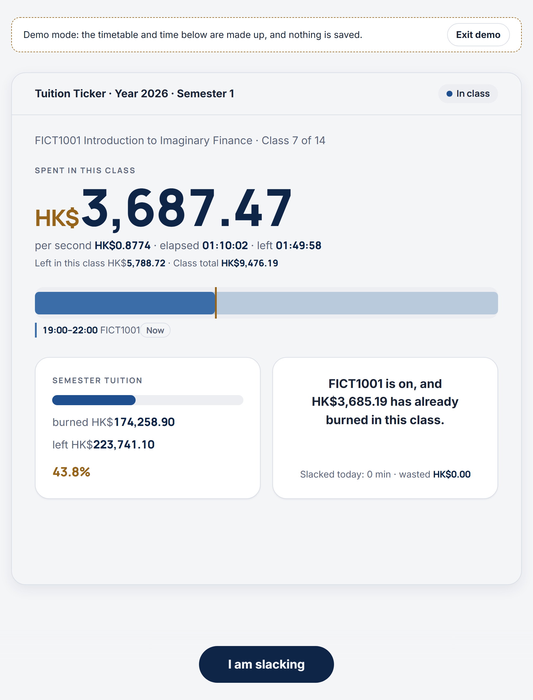
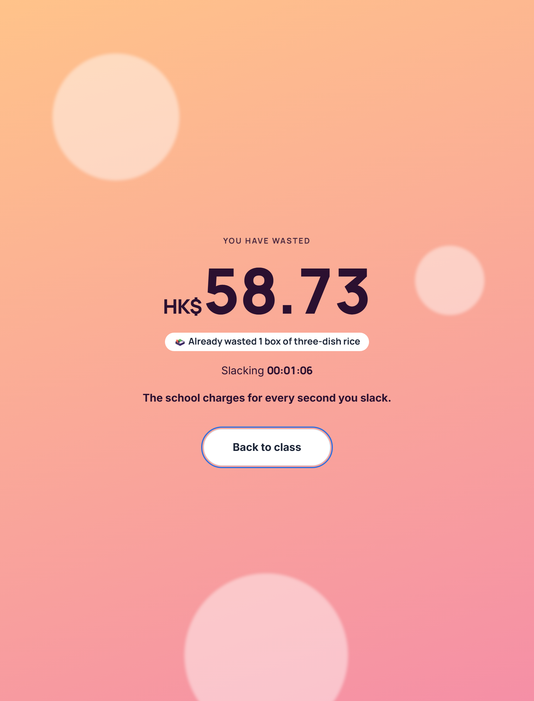

# Uni Motivator（学费计价器）

[English](README.md) | **简体中文**

> 你的学费是一台出租车计价器，而你是坐在后座刷手机的那位乘客。

**Uni Motivator**（软件界面里叫 *Tuition Ticker*，中文名「学费计价器」）把你交的学费换算成「每秒多少钱」。读入你的课表后，它自动知道你现在是不是在上课，并实时告诉你：这节课已经烧掉了多少钱，精确到分。摸鱼的时候计价器照跑不误，还会换成一个全屏页面，告诉你刚刚扔掉了几个蛋挞。所有数据都在你自己的电脑上，免费开源。

| 上课上到一半：计价器正在跑 | 点一下「我要摸鱼」 |
|:-:|:-:|
|  |  |

<sub>截图来自内置的演示模式（界面为英文）：课表和金额都是虚构的。</sub>

## 功能

**实时计价**

- 当前这节课的每秒计费：已花费、本节剩余、本节总价、每秒成本、已上和剩余时间，外加进度条。
- 画面会跟着你的一天自动切换：上课中、课间、今日已下课、今天没课、学期未开始、学期已结束。不需要点「开始」或「结束」。
- 学期（或学年）学费「油箱」、今日时间线；两节课时间重叠时可一键切换。
- 浏览器标签页标题实时显示金额，切到别的标签也能看着它烧。
- 轮播文案三档：温和、正常、焦虑拉满。
- 防偷看模式：有人路过时按 `B` 键，所有金额立刻模糊。

**摸鱼模式**

- 「我要摸鱼」打开全屏页面，实时跳动你正在浪费的钱。
- 把金额折合成日常小东西（蛋挞、奶茶、盒饭、电影票、飞东京的机票……），内置 17 件物品的价格包。
- 回到课堂时弹出结算卡：摸鱼时长、折合物品、本节累计摸鱼。下课时摸鱼会自动结束。

**课节、标记与统计**

- 每周课节列表：标记翘课或停课，填写迟到、早退的分钟数，统计「被学校吞掉」和「翘课损失」。
- 翘课计算器：「翘掉这节 = 扔掉 HK$X，约等于 N 碗车仔面」。
- 周、学期、学年统计：花费、上课时长、出勤率、摸鱼总额和摸鱼率、最爱摸鱼的课、最长一次摸鱼、最贵的一节课、按课程的排行（含每小时成本）、每周花费图表和逐年历史。
- 分享卡片：一键生成 1080 x 1440 的 PNG，不含姓名和学校名。
- 上课提醒：上课前和下课时发浏览器通知。

**课表与计费**

- 导入 `.ics` 文件、Google 日历导出的 `.zip`，或粘贴 iCal 订阅链接（每 6 小时同步，也可手动同步）。支持重复事件、例外日期、单节改期和时区。
- 课程识别：按标题和课程代码分组，Lecture / Tutorial / Lab 自动合并为一门课，考试、假期会被标出来方便你取消勾选。
- 手动添加课节：每周固定的课（可设跳过日期），或一次性的补课。软件会显示新的每秒单价，确认后才重新计算。
- 按学期或按学年计费；按课时或按学分分摊学费；可设学年起始日和学期分割日。分割日智能检查会找出你的寒假并建议更合适的日期。
- 七种货币（HKD、CNY、USD、GBP、EUR、CAD、AUD），可选「第二币种」以小字显示，汇率内置且可手动修改。
- 多学年：导入新学年的日历，旧学年自动归档为只读，统计仍包含它们。

**软件本身**

- 首次启动 7 步引导；也可以点「先看看演示」，用虚构课表随便逛逛，什么都不会保存。
- 界面语言：简体中文、繁體中文、English；可调整界面大小。
- 备份导出 / 导入；「重置全部数据」会先留一份副本。

## 快速开始

在[最新 Release](https://github.com/ELjagi623/Uni-Motivator/releases/latest) 下载下面的压缩包之一，解压到任意位置，双击启动。

| 版本 | 大小 | 需要 | 启动方式 |
|---|---|---|---|
| **轻量版**（`Uni-Motivator-vX.Y.Z-lite.zip`） | 不到 1 MB | 先装一次 [Node.js](https://nodejs.org/) 22 或更高版本 | Windows：双击 `start.cmd`；macOS：双击 `start.command` |
| **免安装版，Windows**（`Uni-Motivator-vX.Y.Z-win-x64-portable.zip`） | 约 38 MB | 什么都不用装，已自带官方 Node.js 运行环境 | 仅限 Windows x64：双击 `start.cmd` |
| **免安装版，macOS**（`Uni-Motivator-vX.Y.Z-macos-arm64-portable.zip`） | 约 44 MB | 什么都不用装，已自带官方 Node.js 运行环境 | 仅限 Apple 芯片（M1 及更新）：双击 `start.command`。Intel Mac 请用轻量版 |

浏览器会自动打开页面（地址形如 `http://127.0.0.1:4280`），关闭那个黑色的命令窗口就停止服务。第一次打开会进入 7 步引导：语言、学校与地区、学费、学年日期、导入日历、识别课程、预览确认。

> [!NOTE]
> macOS 对下载来的脚本会有一次安全确认：第一次请在 Finder 里**右键 `start.command`，选择「打开」，再点一次「打开」**。如果在 macOS 15 或更新的系统上没有「打开」按钮，请到「系统设置」→「隐私与安全性」点**「仍要打开」**。如果提示没有权限，在「终端」执行一次 `chmod +x start.command`。

## 怎么把课表导进来

- **Google 日历：** 在电脑上打开，点齿轮，**设置**，**导入和导出**，**导出**。把下载的 `.zip`（或里面的某个 `.ics`）拖进引导第 5 步，或者「设置」里的「日历」。
- **学校教务系统：** 一般都能导出 `.ics`，同样直接导入。
- **订阅链接：** 在设置里粘贴 http / https 的 iCal 链接，软件会自动保持同步。

> [!WARNING]
> Google 日历的「iCal 格式的私密地址」相当于密码，请不要发给别人。

## 钱是怎么算的

- 每秒成本 = 一个学费池（一个学期或一个学年）的学费 ÷ 这个池里所有计划上课的总时长。
- 已花费 = 每秒成本 × 已经过去的上课时间。所有数字每次都由「课表 + 系统时间」重新算出，不靠后台累加，所以电脑睡眠过，或者软件一周没开，数字依然正确。
- 学费已经交了，所以翘课、停课、迟到的课依然算「已花费」，只是会另外记成损失：「被学校吞掉」「翘课损失」「迟到损失」。已花费加剩余永远等于学费总额。

## 隐私

- 所有数据都保存在软件文件夹旁的 `data/` 目录：设置、标记、摸鱼记录和你导入的日历。没有账号，没有云端，没有统计上报。
- 服务只监听 `127.0.0.1`，局域网里的其他设备访问不到；写入请求还要求自定义请求头，防止别的网页偷偷调用。
- 软件不会主动联网。唯一的例外是你自己添加了 iCal 订阅链接：此时本机服务会去下载那个日历。链接只保存在本机，不会出现在页面、日志或备份里。汇率表是内置的，不联网获取。
- 想完全清除：关闭软件，删除整个文件夹（或只删 `data/`）。

## 常见问题

**Windows 防火墙会弹窗吗？** 不会，服务只监听本机回环地址。

**打不开页面 / 端口被占用？** 默认端口是 4280。被占用时软件会依次尝试 4281 到 4290，并在命令窗口里显示实际地址。也可以自己指定：`start.cmd --port 5000`。

**（轻量版）双击后一闪而过？** 电脑上没有 Node.js，或版本低于 22。请到 <https://nodejs.org/> 安装 LTS 版本。免安装版不需要它。

**时间不准？** 软件使用你电脑的系统时间。请确认已开启自动对时、时区正确。

**怎么升级？** 把新版解压到别处，再把旧的 `data/` 文件夹复制过去；也可以用「备份导出 / 导入」。

**换学校 / 想重来？** 删除 `data/` 后重新打开即可。新学期、新学年不需要重来：在「设置」→「学年管理」导入新日历。

> [!NOTE]
> 开发和测试只在 Windows + Chromium 内核浏览器（Chrome、Edge）上进行。Firefox、Safari、macOS **尚未验证**，详见 [docs/COMPAT.md](docs/COMPAT.md)；macOS 免安装版只做过打包后的静态检查，还没有在真正的 Mac 上运行过。简体中文是原文；English 和繁體中文的界面文字未经母语者校对，用词可能不够地道，欢迎提 Issue 或 PR。

## 从源码运行

需要 Node.js 22 或更高版本。开发约定与贡献方式见 [CONTRIBUTING.md](CONTRIBUTING.md)。

```bash
npm install
npm run dev        # 开发模式：Vite + 本地服务
npm test           # 单元测试与服务端测试
npm run build      # 构建 app/
npm run release    # 在 release/ 下生成轻量版 zip
node scripts/release.mjs --skip-build --portable "C:/Program Files/nodejs/node.exe"   # Windows 免安装版 zip
```
